<p align="right"><b>Русский</b> | <a href="README.en.md">English</a></p>

[](#) [](#) [](#) [](https://github.com/bkaganovich-stack/pixel-volte-patch/releases)

# Активация VoLTE и VoWiFi на смартфонах Google Pixel без Root-прав и разблокировки загрузчика

---

**Pixel IMS** включает поддержку звонков с передачей голоса по сети LTE (VoLTE) и через Wi-Fi (VoWiFi) на смартфонах Google Pixel в сетях операторов, для которых Google программно ограничила эти функции.

Работа приложения строится на базе штатного системного API `CarrierConfigManager` с использованием привилегий **Shizuku-Next** (адаптированного форка Shizuku с полной поддержкой Android 16–17):
* **Безопасно для системы:** загрузчик (Bootloader) остается заблокированным, гарантия сохраняется.
* **Полная совместимость:** Google Wallet, банковские клиенты и государственные сервисы работают в штатном режиме.
* **Автоматическое восстановление:** фоновый сервис возвращает настройки после перезагрузки смартфона.

---

## Содержание
1. [Шаг 1. Скачивание и установка приложений](#-шаг-1-скачивание-и-установка-приложений)
2. [Шаг 2. Активация меню «Для разработчиков»](#-шаг-2-активация-меню-для-разработчиков)
3. [Шаг 3. Сопряжение и запуск Shizuku-Next](#-шаг-3-сопряжение-и-запуск-shizuku-next)
4. [Шаг 4. Включение VoLTE и VoWiFi](#-шаг-4-включение-volte-и-vowifi)
5. [Шаг 5. Проверка работоспособности](#-шаг-5-проверка-работоспособности)
6. [Сохранение настроек после перезагрузки](#-сохранение-настроек-после-перезагрузки)
7. [Решение частых проблем (FAQ)](#-решение-частых-проблем-faq)
8. [Возможности этого форка и сборка из исходников](#-возможности-этого-форка-и-сборка-из-исходников)
9. [Лицензия и благодарности](#-лицензия-и-благодарности)

---

## 📥 Шаг 1. Скачивание и установка приложений

1. Перейдите на страницу релизов [**Shizuku-Next**](https://github.com/rushiranpise/Shizuku-Next/releases), раскройте вкладку **Assets** у самой свежей версии, скачайте файл с расширением `.apk` и установите его.
2. Перейдите в раздел релизов [**Pixel IMS**](https://github.com/bkaganovich-stack/pixel-volte-patch/releases), аналогично откройте блок **Assets**, скачайте `.apk` и установите приложение на смартфон.

<p align="center">
  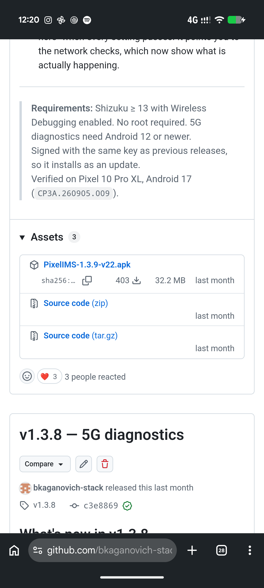
  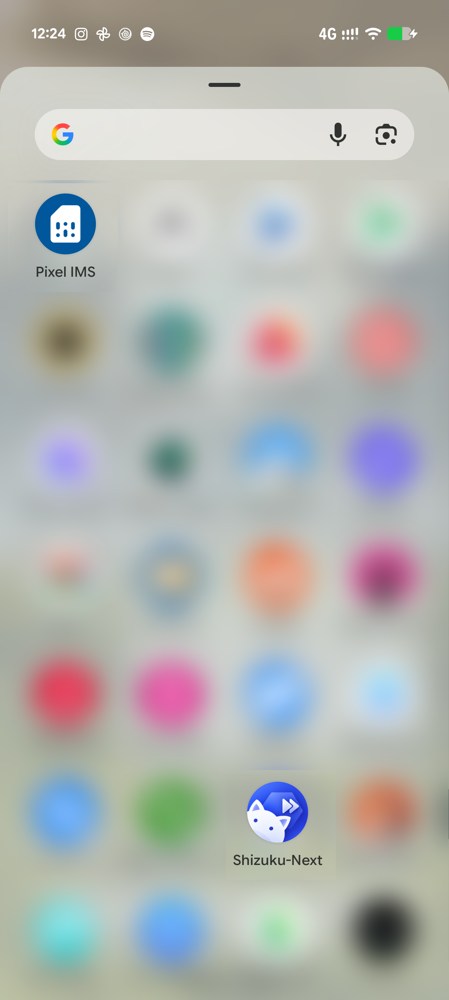
</p>

---

## ⚙️ Шаг 2. Активация меню «Для разработчиков»

Для передачи конфигурационных параметров модему потребуется включить встроенный отладочный интерфейс Android.

1. Откройте **Настройки** смартфона → пролистайте список до конца и выберите пункт **О телефоне**.
2. Опуститесь в самый низ экрана до строки **Номер сборки**.
3. Быстро нажмите на **Номер сборки** 7 раз подряд.
4. Подтвердите действие вводом вашего стандартного ПИН-кода или графического ключа блокировки экрана — внизу появится уведомление *«Вы стали разработчиком!»*.

<p align="center">
  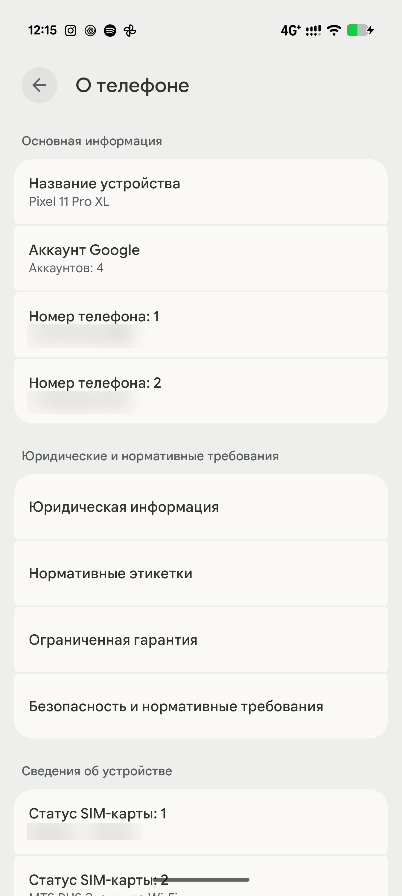
  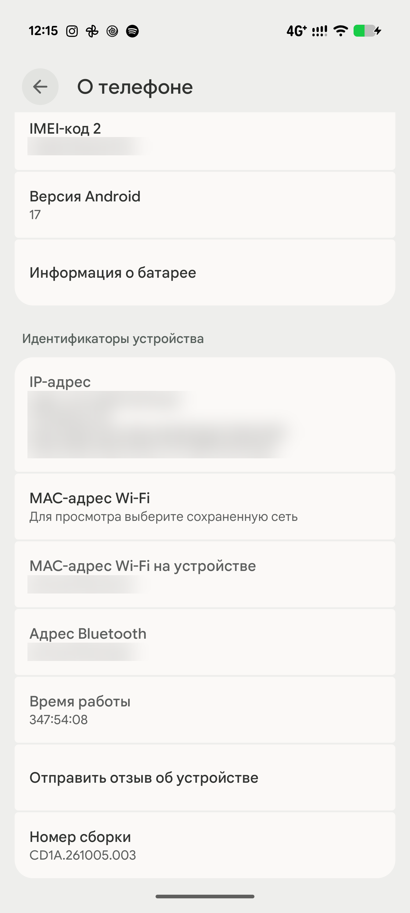
</p>

---

## 🔗 Шаг 3. Сопряжение и запуск Shizuku-Next

> [!IMPORTANT]
> На время первичного сопряжения смартфон должен быть подключен к любой сети Wi-Fi (домашний роутер или точка доступа с другого телефона). После завершения настройки Wi-Fi можно отключать.

1. Откройте приложение **Shizuku** (Shizuku-Next).
2. В блоке **Запуск через отладку по Wi-Fi** нажмите кнопку **Сопряжение** (Pairing). Разрешите приложению отправку уведомлений при появлении системного запроса.
3. Нажмите кнопку **Параметры разработчика** — откроется системное меню настроек.
4. Пролистайте страницу вниз до блока «Отладка» и активируйте три параметра:
   * Включите переключатель **Отладка по USB**.
   * Включите переключатель **Отладка по Wi-Fi** (отметьте галочку *«Всегда разрешать для этой сети»* и нажмите **Разрешить**).
   * Чуть ниже активируйте пункт **Отключить автоматический отзыв авторизации adb** (предотвращает сброс разрешений при простое).
5. Нажмите **прямо на текст строки «Отладка по Wi-Fi»** (слева от тумблера), чтобы перейти внутрь настроек беспроводной отладки.
6. Выберите **Подключение устройства с помощью кода сопряжения** — на экране появится шестизначный цифровой код.
7. Не закрывая окно с кодом, потяните верхнюю шторку уведомлений вниз. В плашке от Shizuku *«Найдена служба сопряжения»* нажмите **Ввести код сопряжения**, укажите 6 цифр с экрана и нажмите кнопку отправки.
8. Вернитесь на главный экран **Shizuku-Next** и нажмите кнопку **Запустить** (Start). Через 3–5 секунд статус сменится на **«Shizuku запущен»**.

<p align="center">
  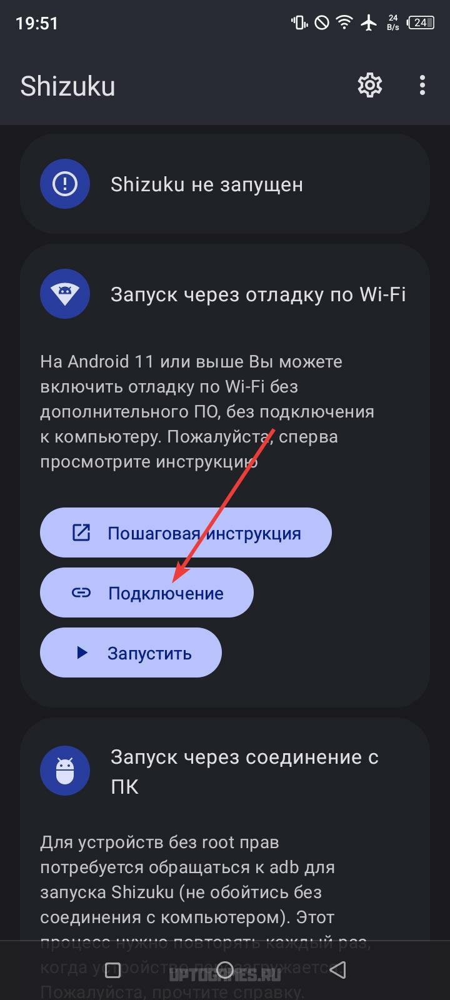
  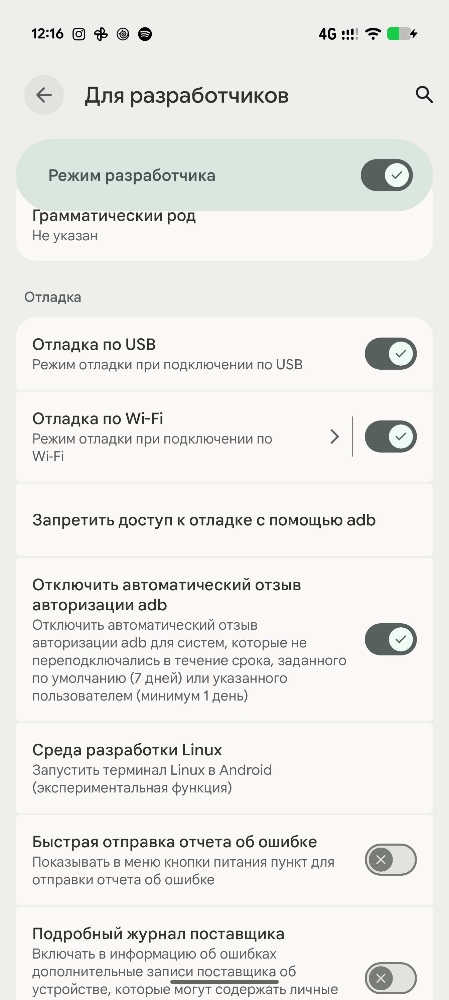
  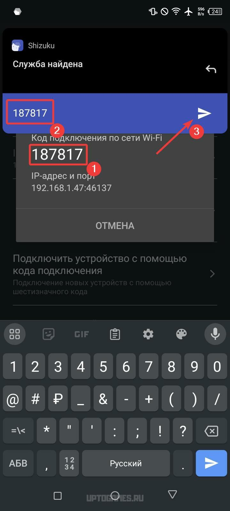
  <br><sub>Первый и третий скриншоты (классический Shizuku): <a href="https://nekolands.com/games/shizuku-gajd-po-nastrojke-i-polucheniju-dostupa-k-papke-data-obb/">nekolands.com — «Shizuku: гайд по настройке»</a></sub>
</p>

---

## 🚀 Шаг 4. Включение VoLTE и VoWiFi

1. Запустите **Pixel IMS**.
2. В появившемся диалоговом окне от Shizuku выберите **Разрешить всегда** (Allow all the time).
3. Выберите нужную SIM-карту (при использовании связки физической SIM и eSIM патч применяется к каждой карточке по очереди).
4. Активируйте переключатели **VoLTE** и **VoWiFi**, после чего нажмите кнопку применения патча.
5. Модем смартфона перезапустит регистрацию в сети (индикатор антенны в статус-баре погаснет и снова появится через 2–3 секунды).

> [!TIP]
> После применения патча рекомендуется зайти в системные **Настройки → Сеть и интернет → SIM-карты → [Ваш оператор]** и убедиться, что появившиеся штатные тумблеры **Вызовы 4G (VoLTE)** и **Вызовы по Wi-Fi** переведены в активное положение.

<p align="center">
  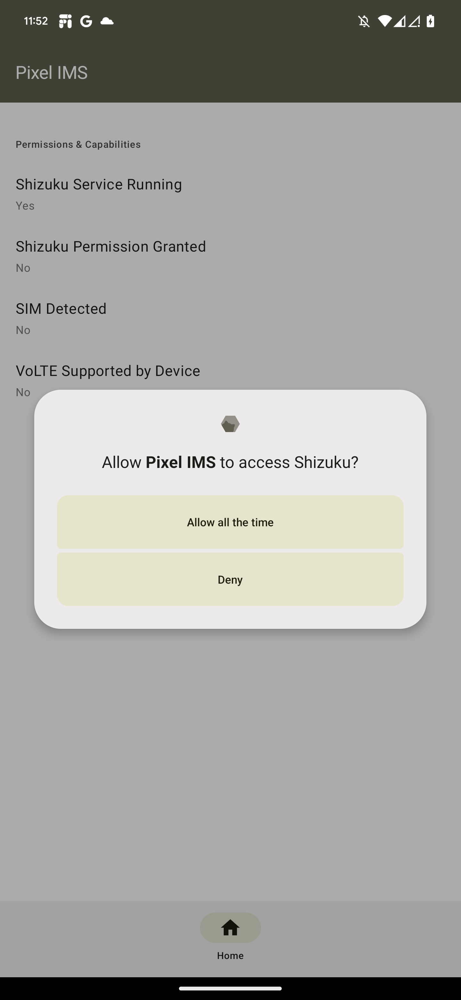
  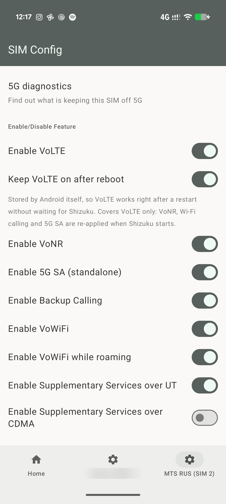
  <br><sub>Первый скриншот: <a href="https://github.com/kyujin-cho/pixel-volte-patch">kyujin-cho/pixel-volte-patch</a> (README, GPL-3.0)</sub>
</p>

---

## ✅ Шаг 5. Проверка работоспособности

### Способ 1. Тестовый звонок
1. Отключите Wi-Fi, чтобы в правом верхнем углу экрана отображался значок мобильной передачи данных **LTE** или **4G**.
2. Совершите исходящий вызов на любой номер.
3. Если во время гудков и разговора индикатор **LTE / 4G** сохраняется в строке состояния (без переключения в `H+`, `3G` или `E`), а дозвон происходит за 1–2 секунды — голосовая связь по LTE активна.

### Способ 2. Проверка статуса IMS в сервисном меню Pixel
1. Откройте стандартное приложение **Телефон** и наберите на цифровой клавиатуре команду:
   ```text
   *#*#4636#*#*
   ```
2. В автоматически открывшемся меню выберите **Информация о телефоне** (`Phone 0` соответствует первой SIM-карте, `Phone 1` — второй).
3. Нажмите на иконку **трех точек (⋮)** в правом верхнем углу и откройте **Состояние службы IMS** (IMS Service Status).
4. Проверьте текущие значения параметров:
   * **Регистрация IMS:** `Зарегистрировано` (Registered)
   * **Голосовая связь по LTE:** `Доступно` (Available)
   * **Голосовая связь по Wi-Fi:** `Доступно` (Available — при подключенном Wi-Fi и поддержке со стороны оператора)

<p align="center">
  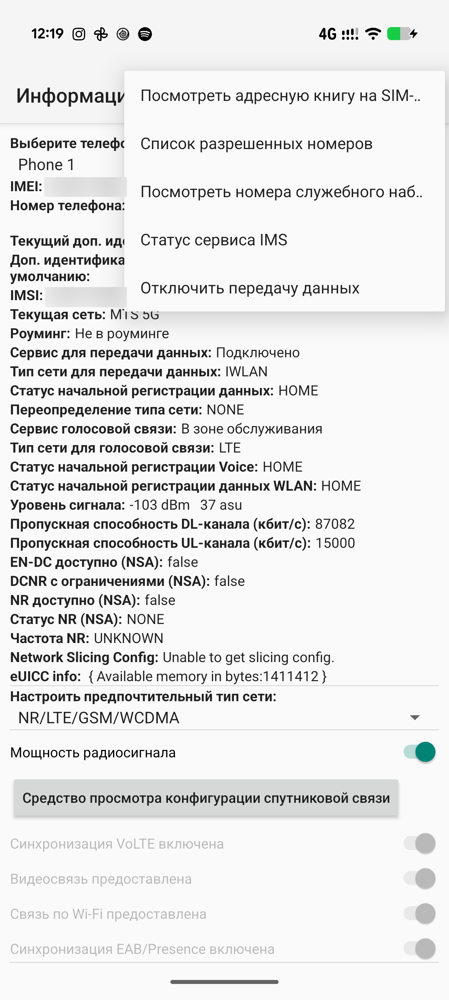
  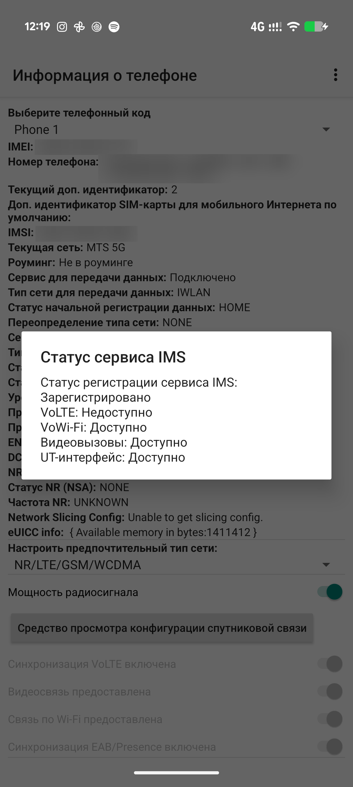
</p>

---

## 🔄 Сохранение настроек после перезагрузки

Архитектура безопасности Android сбрасывает переопределения `CarrierConfig` при полной перезагрузке смартфона или установке ежемесячных ОТА-обновлений. Для автоматического восстановления VoLTE в фоновом режиме выполните два действия:

1. **Отключите оптимизацию батареи для обоих приложений:**
   * Откройте **Настройки → Приложения → Показать все приложения**.
   * Выберите **Shizuku**, перейдите в пункт **Использование батареи приложением**, нажмите прямо на текст строки *«Разрешить работу в фоновом режиме»* и отметьте профиль **Без ограничений**.
   * Повторите эту же процедуру для приложения **Pixel IMS**.
1. **Включите автозапуск в Shizuku-Next:**
   * В настройках Shizuku-Next активируйте опции **Запуск при загрузке** (Start on boot) и фоновый мониторинг (**Watchdog**). После перезагрузки телефона и подключения к сети сервис поднимется сам, а **Pixel IMS** автоматически применит конфигурацию модема.

---

## 🛠 Решение частых проблем (FAQ)

Ниже собраны решения типовых затруднений, возникающих при первичной настройке на Android 16–17. Нажмите на описание проблемы, чтобы развернуть инструкцию.

<details>
<summary><b>1. В шторке уведомлений не появляется поле для ввода кода сопряжения Shizuku</b></summary>
<br>

На смартфонах с Android 16–17 система может блокировать всплывающее окно ввода, если уведомлениям Shizuku назначен низкий приоритет или включен режим «Не беспокоить».
* Перейдите в **Настройки → Приложения → Shizuku → Уведомления** и убедитесь, что все категории уведомлений включены.
* В системном меню **Отладка по Wi-Fi** удалите старые привязки в списке «Подключенные устройства», выключите и снова включите тумблер **Отладка по Wi-Fi**, после чего повторно нажмите кнопку **Сопряжение** в Shizuku-Next.
* Если уведомление свернуто, потяните за него двумя пальцами вниз или нажмите на маленькую стрелочку в правом углу плашки уведомления.
</details>

<details>
<summary><b>2. Ввод кода сопряжения зависает на статусе «Поиск службы сопряжения...»</b></summary>
<br>

Такое поведение возникает, когда локальная сеть блокирует сетевое обнаружение (mDNS) или телефон подключен к гостевому Wi-Fi с изоляцией клиентов.
* Перезагрузите Wi-Fi на смартфоне или временно раздайте точку доступа с любого другого телефона и подключитесь к ней.
* Если на смартфоне запущен VPN-клиент или персональный DNS-фильтр (например, AdGuard в режиме локального VPN), отключите его на 2 минуты во время ввода 6-значного кода.
* Убедитесь, что в разделе **Для разработчиков** включен не только пункт «Отладка по Wi-Fi», но и базовый тумблер **Отладка по USB**.
</details>

<details>
<summary><b>3. Патч успешно применен, но в меню *#*#4636#*#* статус IMS — «Не зарегистрировано»</b></summary>
<br>

Телефон разблокировал функцию программно, но базовая станция оператора еще не выдала разрешение вашей SIM-карте.
* Включите **Режим полета** (Авиарежим) на 10–15 секунд и выключите его, чтобы инициировать повторную авторизацию модема.
* Проверьте в официальном мобильном приложении вашего сотового оператора, подключена ли на номере бесплатная услуга **«VoLTE»** / **«Вызовы 4G»**. У ряда операторов эта опция по умолчанию отключена в биллинге, если SIM-карта ранее не устанавливалась в сертифицированный ими смартфон.
* Если SIM-карта используется более 5–7 лет, обратитесь в салон связи для бесплатной замены на новую USIM или перевыпустите профиль eSIM.
</details>

<details>
<summary><b>4. В настройках «Для разработчиков» переключатель «Отладка по Wi-Fi» серый (неактивен)</b></summary>
<br>

Беспроводная отладка в Android работает только при активном соединении с сетью Wi-Fi.
* Подключитесь к любой точке доступа Wi-Fi — сразу после получения IP-адреса переключатель станет доступным для нажатия.
* Проверьте раздел **Настройки → Защита и конфиденциальность → Дополнительные настройки защиты** — если там включена функция **Автоблокировка (Advanced Protection)**, временно отключите ее, так как она блокирует интерфейс ADB.
</details>

<details>
<summary><b>5. После перезагрузки телефона настройки VoLTE слетают</b></summary>
<br>

Это штатное поведение системы Android при холодном старте. Чтобы возврат настроек происходил без ручного вмешательства:
* Проверьте, что для **Shizuku-Next** и **Pixel IMS** выставлен режим энергопотребления **Без ограничений** (см. раздел [Сохранение настроек после перезагрузки](#-сохранение-настроек-после-перезагрузки)).
* Убедитесь, что в меню **Для разработчиков** включен тумблер **Отключить автоматический отзыв авторизации adb** — без него система отзывает ключи отладки каждые 7 дней.
</details>

---

## 🧩 Возможности этого форка и сборка из исходников

Форк основан на ветке с исправлением для Android 16 QPR2 Beta 3 от [tdrkDev](https://github.com/tdrkDev/pixel-volte-patch) и добавляет к оригинальному Pixel IMS:

* **Сохранение настроек** — каждое изменение переключателя автоматически сохраняется.
* **Автоматическое повторное применение** — сохраненная конфигурация применяется заново, когда настройки оператора могли быть сброшены: после перезагрузки, после обновления приложения и при перезагрузке системой конфигурации оператора. Задача ставится в постоянную фоновую очередь (WorkManager) и выполняется, как только Shizuku становится доступен. Если текущая конфигурация уже совпадает с сохраненной, IMS не перезапускается. Опция включается на вкладке **Home** переключателем **Auto-apply settings on reboot**.
* **Экспорт и импорт** — на вкладке **Home** можно сохранить настройки всех SIM-карт в JSON-файл (**Export settings to file**) и восстановить их на другом устройстве (**Import settings from file**).

### Сборка из исходников

Для сборки нужен **пропатченный `android.jar`**, открывающий скрытые API телефонии:

```bash
# Заменить стандартную заглушку SDK пропатченной версией
curl -L https://github.com/Reginer/aosp-android-jar/raw/main/android-36/android.jar \
     -o "$ANDROID_HOME/platforms/android-36/android.jar"

# Сборка (требуется JDK 17)
./gradlew assembleRelease
```

---

## 📄 Лицензия и благодарности

* Разработка и поддержка форка: [@bkaganovich-stack](https://github.com/bkaganovich-stack)
* Оригинальный Pixel IMS: [kyujin-cho/pixel-volte-patch](https://github.com/kyujin-cho/pixel-volte-patch/tree/main)
* Исправление для Android 16 QPR2 Beta 3: [tdrkDev/pixel-volte-patch](https://github.com/tdrkDev/pixel-volte-patch)
* Оригинальный Shizuku: [RikkaApps/Shizuku](https://github.com/RikkaApps/Shizuku)
* Системный бэкенд: [Shizuku-Next (@rushiranpise)](https://github.com/rushiranpise/Shizuku-Next)
* Лицензия: [GPL-3.0](LICENSE), как и у оригинального проекта.
